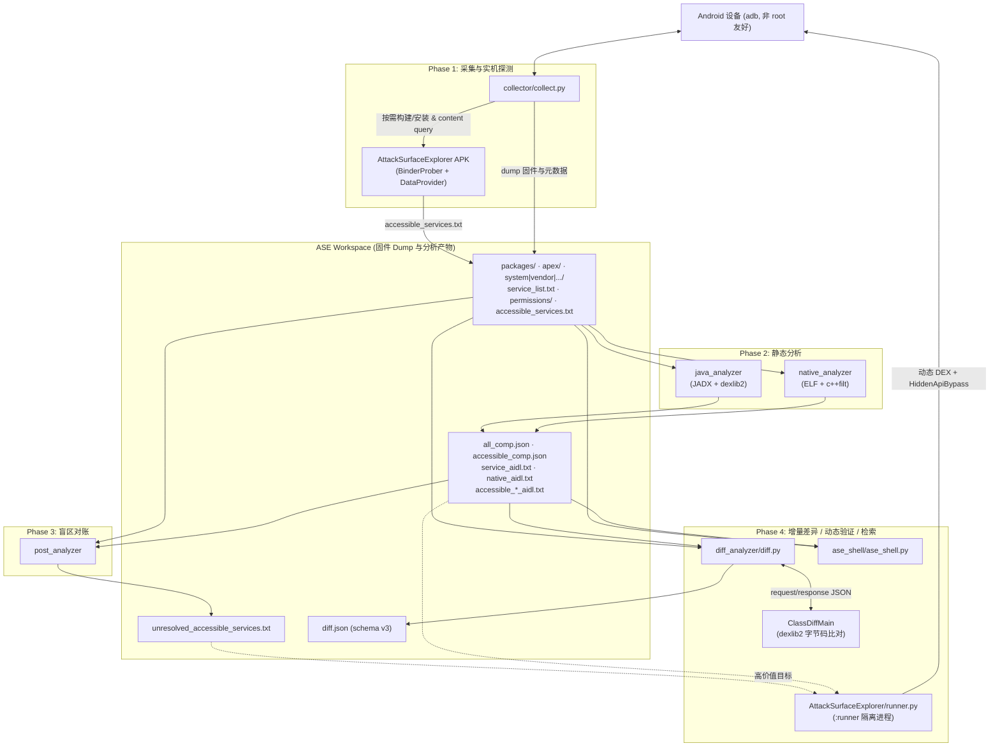

# Android Framework Attack Surface Explorer (ASE) 架构文档

## 1. 系统定位与核心目标

**Android Framework Attack Surface Explorer (ASE)** 是一套面向 Android 固件与系统框架的攻击面测绘、跨版本增量差异分析与动态验证工具链，覆盖：

1. **固件采集与实机可达性测绘**：在**不要求设备 root** 的前提下，拉取 APK、APEX、各分区原生二进制、SELinux 与权限元数据，并结合设备端普通沙箱探针获取真实的低权限服务可达性基准；
2. **Java / Native 双栈静态分析**：分别解析应用组件权限、Java AIDL 实现与 Native ELF Binder 服务端；
3. **盲区对账**：将实机可达服务与静态分析结果求差集，暴露未匹配到标准 AIDL 的高价值盲区服务；
4. **双固件增量差异分析**：对比两个 ASE dump 的包、组件、权限、Binder 接口、APEX 模块，并结合 DEX 方法体级指纹与调用图传播，区分高优先入口变化与低优先兜底变化；
5. **动态 PoC 验证与交互检索**：在隔离进程中快速编译执行 Java/DEX 验证脚本，并提供类 gdb 风格的本地 dump 交互检索工具。

---

## 2. 总体架构与核心工作流

### 四条主要工作流

| 工作流 | 入口 | 链路 | 适用场景 |
|---|---|---|---|
| **全量采集与分析** | `./run.sh <workspace>` | `collector` → `java_analyzer` → `native_analyzer` → `post_analyzer` | 新设备/新固件首次建档 |
| **离线重分析** | `./run.sh <workspace> --analyze-only` | `java_analyzer` → `native_analyzer` → `post_analyzer` | 无需设备，分析器升级后重跑 |
| **双固件差异分析** | `python3 diff_analyzer/diff.py <base> <cand>` | 产物校验 → 静态 diff → `ClassDiffMain` → 聚合输出 `diff.json` | 月度补丁/跨版本攻击面增量审计 |
| **动态验证 & 交互检索** | `AttackSurfaceExplorer/runner.py`、`ase_shell/ase_shell.py` | 本地秒级编译 DEX 推送执行 / 本地 REPL 查询 | 盲区服务实测、包与服务快速检索 |

---

## 3. Workspace 数据契约

所有模块通过统一的 `<workspace>` 目录解耦，各阶段产物的生产与消费关系如下：

| 层次 | 产物 | 生产者 | 主要消费者 | 语义说明 |
|---|---|---|---|---|
| **采集层** | `packages/<pkg>/*.apk`、`package_index.csv` | `collector` | `java_analyzer`、`diff_analyzer`、`ase_shell` | 应用包与 UID 索引 |
| **采集层** | `apex/`、`apex_index.csv` | `collector` | `java_analyzer`、`native_analyzer`、`diff_analyzer` | Mainline APEX 模块与挂载索引 |
| **采集层** | `system/`、`vendor/`、`product/` 等分区文件 | `collector` | `native_analyzer` | ELF 二进制与共享库 |
| **采集层** | `permissions/permissions.txt`、`selinux/`、`init/` | `collector` | `diff_analyzer`、`ase_shell` | 权限定义、SELinux 与启动配置 |
| **采集层** | `service_list.txt`、`accessible_services.txt` | `collector` + `BinderProber` | `java_analyzer`、`native_analyzer`、`post_analyzer`、`diff_analyzer`、`ase_shell` | 已注册服务表与普通沙箱实机可达性基准 |
| **静态层** | `all_comp.json` | `java_analyzer` | `diff_analyzer`、`ase_shell` | 全量组件清单（含 `exported`、`enabled`、权限、intent-filter、path-permission） |
| **静态层** | `accessible_comp.json` | `java_analyzer` | `diff_analyzer`、`ase_shell` | 弱权限可达组件子集（仅 `exported=true` 且 `enabled!=false`） |
| **静态层** | `service_aidl.txt`、`accessible_service_aidl.txt` | `java_analyzer` | `native_analyzer`、`post_analyzer`、`diff_analyzer`、`ase_shell` | Java AIDL 接口、实现类（raw class name）与方法签名 |
| **静态层** | `native_aidl.txt`、`accessible_native_aidl.txt` | `native_analyzer` | `post_analyzer`、`diff_analyzer`、`ase_shell` | Native AIDL 接口、`.so`、backend、`onTransact` 与还原的方法签名 |
| **索引层** | `dex_index.db`（SQLite） | `java_analyzer`（`DexExportMain`） | 全量 Class Diff / SCA / 调用图查询 | 单固件全量 DEX 离线特征库（容器、类、逐方法指纹、字符串倒排、类级调用边） |
| **对账层** | `unresolved_accessible_services.txt` | `post_analyzer` | 人工审计 / `runner.py` | 实机可达但未匹配到 Java/Native AIDL 的盲区服务 |
| **差异层** | `diff.json`（`schema_version: 3`） | `diff_analyzer` | 下游漏洞扫描器 / 人工审计 | 双 dump 结构化差异报告 |

---

## 4. 核心模块架构详解

### 4.1 编排入口：`run.sh`
- 统一串联采集与各分析阶段，支持 `--collect-only`、`--analyze-only`、`--probe-only`、`--components-only`、`--aidl-only` 以及各阶段跳过开关。
- 自动检测 adb 设备、按需触发 `java_analyzer` JAR 构建，保证开箱即用。

### 4.2 采集与探测：`collector`
- **固件采集（`collect.py`）**：通过 `adb` 拉取包、APEX、各分区二进制、init、SELinux、权限及运行态元数据；对非 root 设备自动容错跳过无权限路径，并记录完整 `adb pull` 错误详情；支持 `-s`/`-3`/`--apex-only`/`--probe-only`。
- **APK 按需构建与探针调用**：仓库不跟踪 `app-release.apk`，源码更新或缺失时自动调用 Gradle 构建并 `adb install -r -g`，随后通过 `content query` 查询 `BinderProber` 生成 `accessible_services.txt`。探针缺失时平滑降级为纯静态模式。

### 4.3 Java 静态分析与类差异引擎：`java_analyzer`
由 Gradle 打包为 fat JAR（`analyzer-1.0.0-all.jar`），通过 `analyzer.sh` 自动按需构建并执行，内部包含三大子能力：

1. **组件权限分析（`components/`）**：
   - `ManifestParser` 解析全部 APK 的 `AndroidManifest.xml`，保留所有导出/非导出、启用/禁用组件（含 `activity-alias` 目标继承、deeplink、provider 读写权限与 `path_permission`），输出 `all_comp.json`。
   - `ComponentAnalyzer` 识别 `exported=true && enabled!=false` 且权限未定义或保护级别不足（非 `signature|privileged|system|internal|preinstalled`）的组件写入 `accessible_comp.json`；检测到缺少 `exported` 字段的旧缓存时自动触发重扫。
2. **Java AIDL 搜索（`aidl/` + `jadx/`）**：
   - 扫描 `packages/android/` 及 `apex/*/javalib/`（跳过软链接防重复加载），识别 AIDL 三件套（`Default` / `Stub` / `Stub.Proxy`），沿继承链 BFS 定位实现类并保留底层原始类名（如 `$1`），默认按 `service_list.txt` 过滤（`--ignore-registered` 可全量输出），并结合 `accessible_services.txt` 标记 `[accessible=1|0|unknown]`。
3. **类级/方法级字节码差异引擎（`classdiff/ClassDiffMain.java`）**：
   - 基于 `smali-dexlib2` 的按需延迟索引架构（`SideIndex`）：仅对 `wanted` 目标类计算指纹，控制大 dump 内存占用（默认 `-Xmx4g`，可通过 `ASE_CLASS_DIFF_XMX` 调整）。
   - **逐方法指纹（`computeMethodHashes` + `methodBodyHash`）**：对每个非 synthetic 方法构建抗噪声字节码指纹，再聚合为类级 `bodyHash`：
     - 过滤 `nop` 与寄存器间 `move*`，基于过滤后指令序列构建 `TreeMap` 地址索引映射分支偏移与 `try/catch`；
     - 归并 DEX 编码宽度变体（`/range`、`/2addr`、`/lit8`、`/lit16`、`const-string/jumbo`、`goto/*`、`const/*`、`const-wide/*`）；
     - 归一化编译器/R8 合成符号（`$$ExternalSynthetic*`、`lambda$...$N`、`access$N`、`$r8$*`、`-$$Nest$*`）及非标准库的 R8 短混淆类名/方法名/字段名（仅豁免 `java/`、`javax/`、`kotlin/`、`dalvik/` 等标准库）；
     - 将 Android `0x01`/`0x7f` 资源 ID 常量归一化为 `#RES`。
   - **薄壳内部类补盲**：
     - Binder 侧：对 `$` 内部类（如 `$BinderService`、`$Stub`），自身未变时逐级回退比对其外部类（enclosing class），命中时输出 `enclosing` 字段；
     - 组件侧：基于 DEX 原始 `$` 描述符，仅当内部类方法体实际引用了外部类方法/字段时才回退检查外部类，避免 `Settings$*Activity` 等静态命名空间子类误报。
   - **`{impl, enclosing}` 调用图传播**：
     - 保留 `access$` / `-$$Nest$` 桥接边，构建类内及指向外部类的轻量调用图；
     - Binder 侧从实现类方法出发 BFS，计算受影响的 `changed_methods`；
     - 组件侧按组件类型从不可混淆的框架入口回调（`onCreate`/`onNewIntent`/`onStartCommand`/`onBind`/`onReceive`/`query`/`call` 等）出发 BFS，判定 `entrypoint_changed`。

### 4.4 Native 静态分析：`native_analyzer`
零第三方 Python 依赖，扫描各分区与 `apex/`（去重软链接）的 ELF 二进制：
- **Descriptor 提取**：覆盖标准 AIDL 字符串、C++ `String16` UTF-16LE 常量、非标准命名与 Rust v0 mangling；
- **多层服务端判定**：综合 C++ Itanium ABI（`{len}Bn{Name}`）、Rust mangling 与动态符号表（`AIBinder_Class_define`、`AServiceManager_addService`、`defaultServiceManager`），缓解 strip 与 `-fno-rtti` 漏报；
- **架构与方法还原**：识别 `libbinder` / `ndk` / `rust` backend；交叉引用 `service_aidl.txt` 或解析 `Bp{Name}` 导出符号并调用 `c++filt`/`llvm-cxxfilt` 还原 C++ 方法签名；定位 `Bn{Name}::onTransact` / `on_transact` 虚地址。

### 4.5 盲区对账：`post_analyzer`
读取 `accessible_services.txt`、`accessible_service_aidl.txt`、`accessible_native_aidl.txt` 执行差集对账，输出实机可达但静态未还原出 AIDL 的盲区服务（标记 `no_aidl_matched` 或 `empty_descriptor`），并在终端打印覆盖率汇总。

### 4.6 双固件差异分析：`diff_analyzer`
采用 **Python 主控编排（`diff.py`） + Java 字节码比对 Helper（`ClassDiffMain`）** 两段式结构，默认原子写入 `<candidate>/diff.json`（`schema_version: 3`）：

- **Fail-Closed 产物校验**：任一侧缺失所需产物（含空文件、未落盘的 APEX 模块、非探针格式的 `accessible_services.txt`）默认报错退出（exit 2）；仅显式 `--ignore-missing` 时继续并标记 `unavailable`。
- **APK SHA256 运行期剪枝**：多线程计算 APK SHA256 仅用于跳过未变包的字节码检测，不写入最终报告；不对 `framework/*.jar` 与 APEX `javalib` 做哈希。
- **精简、面向下游扫描器的五段式 Schema**：
  1. `files`：基线与候选路径；
  2. `packages`：`added`/`removed` 仅列包名；`uid_changed` 仅记录跨 `10000` 边界或 `< 10000` 内部变化（`value`/`old`）；`changed` 按包聚合，包级变更（`uses_permissions_*`、`protected_broadcasts_*`、`unresolved_classes`）与 `components` 平级；`components` 内将**入口回调变化（`entrypoint_changed`）**与**其余变化（`changed`，排除不涉及可达性变化的纯清单改动）**互斥拆分；
  3. `permissions`：基于 `permissions/permissions.txt`，`definitions.added/removed` 仅列权限名，`changed` 以 `value`/`old` 记录变化字段；
  4. `binder`：`added`/`removed`、`newly_accessible`/`newly_blocked`（最终可达/不可达集合）置于 `changed` 之前；`changed` 统一收敛接口增删改及纯 `body_changed` Java 服务，通过 `impl.status`（类级兜底）+ `methods_changed`（精确到 `service_aidl.txt` 原始签名的接口方法级变化）形成两层信号，Native 接口同步记录 `so`/`backend` 变化并忽略 `onTransact` 与方法地址前缀；
  5. `apex`：仅输出新增/删除模块（含无依赖 protobuf varint 解析的 `version`、去重嵌套目录后的确定性 `digest` 与文件列表）。

### 4.7 设备端探针与动态验证：`AttackSurfaceExplorer`
- **BinderProber & DataProvider**：以普通 `untrusted_app` 身份反射调用 `ServiceManager.getService(name)` 仅检查 `IBinder` 存活性（不触发业务事务，避免系统服务异常），通过 `content://net.wrlu.ase.probe/binder_service` 导出。`DataProvider` 校验 `Binder.getCallingUid()`，仅允许本应用、`system(1000)`、`shell(2000)`、`root(0)` 访问。
- **动态脚本框架（`runner.py` + `ScriptExecutionService`）**：
  - 主机端自动调用 `javac` + `d8` 将实现 `AseScript` 的 `.java` 编译为 DEX 并推送设备；
  - 设备端 `ScriptExecutionService` 声明 `android.permission.DUMP`（仅 shell/root 可启动，阻断三方应用触发），运行在独立 `:runner` 前台服务进程实现崩溃隔离，且 `HiddenApiBypass` 仅在该进程启用；
  - 动态 DEX 加载前设 `setReadOnly()`，结合 `run_id` 防陈旧结果，输出路径限定在应用目录与 `/data/local/tmp/`，执行结果经 `DataProvider` 以 JSON 回传。

### 4.8 交互式检索：`ase_shell`
- 类 gdb 风格的命令行 REPL（支持 `-c` 非交互执行、命令注册装饰器 `@command`、Tab 补全与 readline 历史、Ctrl+C 安全退出）。
- **词法路径沙箱**：`ctx.resolve()` 仅允许访问 ASE 产物目录与结果文件，不跟随符号链接，自动忽略 `.DS_Store` 及非产物笔记。
- 内置仿 adb 语义命令：`pm list` / `pm list packages [filter]` / `pm list <pkg>` / `pm uninstall <pkg>`（同步清理本地包目录及 `package_index.csv`、`all_comp.json`、`accessible_comp.json` 记录）、`service list [service]`。

---

## 5. 关键横切设计

| 维度 | 设计策略 |
|---|---|
| **按需构建（Zero Binary Tracking）** | 仓库不提交 `app-release.apk` 与 `analyzer-1.0.0-all.jar`；`collector`、`runner.py`、`analyzer.sh` 均在产物缺失或源码更新时自动触发 Gradle 构建 |
| **安全与权限边界** | 设备端不要求 root；`DataProvider` 校验调用方 UID；`ScriptExecutionService` 受 `DUMP` 权限保护、`:runner` 进程隔离、动态 DEX 只读、`result_file` 路径白名单；`ase_shell` 词法路径隔离 |
| **降噪与分层信号** | `diff_analyzer` 结合指令编码归一化、合成符号归一化、资源 ID 归一化、R8 短混淆符号归一化，消除编译与混淆伪变化；同时用类级 `body_changed` 兜底 + `methods_changed`/`entrypoint_changed` 精准分层 |
| **容错与降级** | 非 root `adb pull` 失败容错与详细报错；探针不可用时降级为纯静态分析；`c++filt` 缺失时告警跳过签名还原；`diff_analyzer` 默认 Fail-Closed，支持 `--ignore-missing` 显式降级 |

---

## 6. 技术栈与外部依赖

- **Python 3.9+**：`collector`、`native_analyzer`、`post_analyzer`、`diff_analyzer`、`ase_shell`、`runner.py`（均无第三方 Python 包依赖，仅使用标准库）
- **Java 21+ / Gradle 8.5+**：`java_analyzer`（JADX + `smali-dexlib2` + Gson）、`AttackSurfaceExplorer`（Android SDK 37 + `HiddenApiBypass`）
- **系统工具**：`adb`（设备交互）、`c++filt` / `llvm-cxxfilt`（可选，Native C++ 方法签名 demangle）
